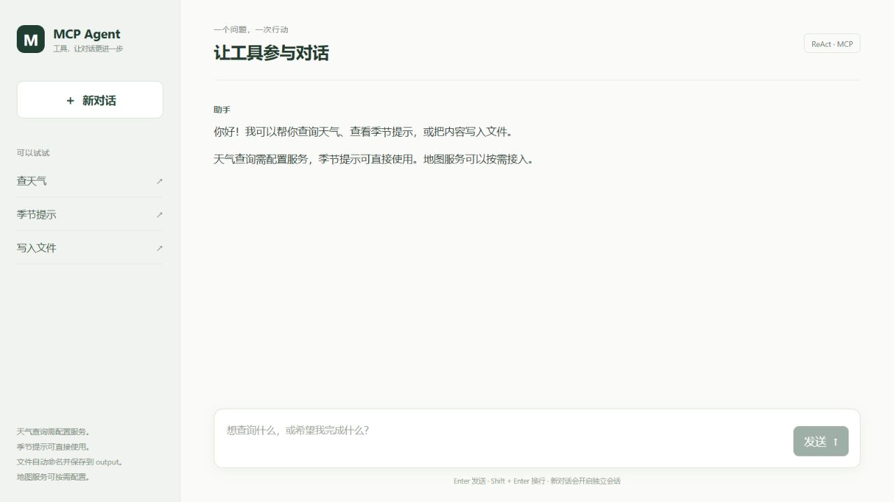
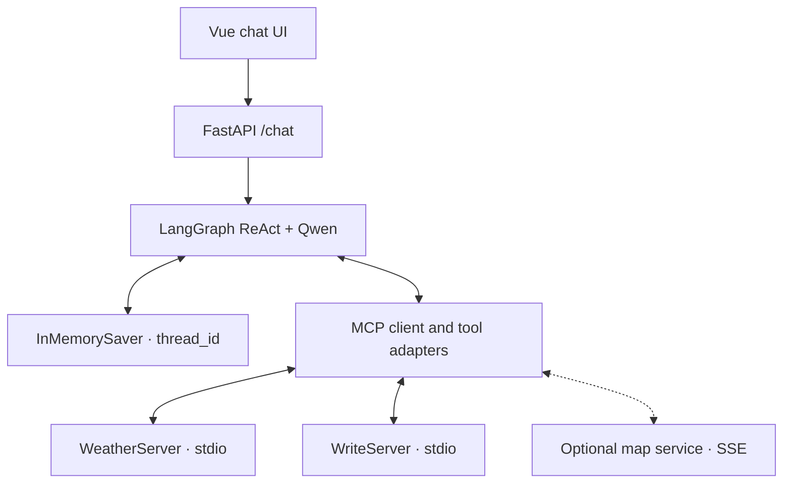

# MCP ReAct Agent

**An extensible ReAct agent powered by MCP, LangGraph, Qwen, FastAPI, and Vue.**

[](https://www.python.org/)
[](https://vuejs.org/)
[](LICENSE)

[简体中文](README.md) · English

A local Web application that turns natural language requests into MCP tool calls. Qwen chooses tools and generates arguments through a LangGraph ReAct loop; FastAPI exposes the agent, and Vue displays the final response.

This repository independently implements the supplied feature requirements, including portable configuration, isolated conversations, and a complete Web interface.



Welcome-page screenshot. Configure the model and external services using the instructions below.

## Features

- Two local FastMCP servers with three tools: current weather, seasonal tips, and file writing.
- Configuration-driven tool discovery through `MultiServerMCPClient`, with stdio and optional remote SSE connections.
- LangGraph ReAct tool selection and multiple tool calls without keyword-based business routing.
- In-process conversation checkpoints isolated by an explicit `thread_id`.
- FastAPI lifespan management of persistent MCP sessions through `AsyncExitStack`.
- Vue chat UI with Markdown rendering, loading and error states, HTML disabled, and link protocol filtering.
- Optional-server degradation visible in `/health`; required-server initialization failures prevent startup.

## Architecture



The model chooses a tool, observes its result, and decides whether to call another tool or return an answer. Tools are discovered at startup; adding a compatible MCP server usually requires configuration and a restart, without changes to the reasoning loop. Runtime hot reload is not implemented.

See the [architecture document](docs/architecture.md) and [feature-to-source map](docs/source-map.md) in Chinese.

## Quick start

Requirements: Python 3.11+, Node.js 22.12+ or Node.js 20.19+ within the 20.x line, and a valid DashScope API key for Qwen. OpenWeather requires its own key for weather queries. Seasonal tips and file writing do not require an OpenWeather key.

```bash
git clone https://github.com/Lh0326/mcp-react-agent.git
cd mcp-react-agent
```

Windows PowerShell:

```powershell
py -3.11 -m venv .venv
.\.venv\Scripts\Activate.ps1
python -m pip install -r requirements.txt
Copy-Item .env.example .env
```

macOS / Linux:

```bash
python3.11 -m venv .venv
source .venv/bin/activate
python -m pip install -r requirements.txt
cp .env.example .env
```

Edit the root `.env` file:

```dotenv
DASHSCOPE_API_KEY=your_dashscope_api_key
MODEL=qwen-plus
OPENWEATHER_API_KEY=your_openweather_api_key
AMAP_MCP_SSE_URL=
CORS_ORIGINS=http://localhost:5173,http://127.0.0.1:5173
AGENT_TIMEOUT_SECONDS=120
```

Start the backend:

```bash
python api_server.py
```

The API runs at `http://127.0.0.1:8000`. Visit `/docs` for the schema and `/health` for loaded tools. The backend starts local MCP subprocesses automatically.

In a second terminal, start the frontend:

```bash
cd frontend
npm ci
npm run dev
```

Open the displayed URL, usually `http://localhost:5173`. Vite proxies `/api` to `http://127.0.0.1:8000`. Use `frontend/.env.local` with `VITE_API_BASE_URL` for another backend URL, and update `CORS_ORIGINS` when making direct cross-origin requests.

You can also use the agent directly without starting the Web application:

```bash
python client.py
python client_simple.py "Get summer weather tips and save them to a local file."
```

Each standalone process has its own sessions and conversation state.

## Try it

Example requests, with model-dependent tool selection and output:

```text
Get summer weather tips and save the advice to a local file.
Check the current weather in Beijing, add winter tips, and save a summary.
My next trip is to Shanghai. Remember that city.
What is the weather there now?
```

The first request can exercise both the tips and writing tools without an OpenWeather key. Weather queries require a valid key and network access. Generated files are written under the root `output/` directory. Reuse the same `thread_id` for follow-up requests.

## Configuration and tools

`servers_config.json` declares connections:

| Server | Transport | Default | Failure policy |
| --- | --- | --- | --- |
| `weather` | stdio | Enabled | Required; failure stops initialization |
| `write` | stdio | Enabled | Required; failure stops initialization |
| `amap-maps` | SSE | Disabled | Optional; failure degrades the service |

`${PYTHON_EXECUTABLE}` resolves to the current interpreter. Relative script paths resolve against the project root. To enable maps, provide `AMAP_MCP_SSE_URL`, set `amap-maps.enabled` to `true`, restart, and inspect `/health`. Remote tool names and capabilities come from the service provider.

Environment placeholders support `${VAR}` and `${VAR:-default}`. The weather key may be empty so the seasonal tool can still load. stdio subprocesses receive explicit UTF-8 settings, allowlisted proxy and certificate variables, and service-specific environment values; the model key is not passed as a tool subprocess environment parameter.

| Tool | Argument | Behavior |
| --- | --- | --- |
| `query_weather` | `city: str`, e.g. `Beijing` | Fetch current OpenWeather observations |
| `get_weather_tips` | `season: str` | Built-in tips for `spring`, `summer`, `autumn`, or `winter` |
| `write_file` | `content: str` | Create a text file in the fixed `output/` directory |

Add a FastMCP server using typed functions decorated with `@mcp.tool()`, then register its connection next to the existing servers. Restart to discover the new tools. See the [Chinese example](README.md#新增-mcp-服务).

## API

`GET /health` returns initialization state, model, loaded tools, and degraded servers. It does not prove that external model or weather requests have succeeded.

`POST /chat` requires both `message` and `thread_id`:

```bash
curl -X POST http://127.0.0.1:8000/chat \
  -H "Content-Type: application/json" \
  -d '{"message":"Get summer tips and save them.","thread_id":"demo-001"}'
```

Responses contain `content`, `status`, `error`, and `thread_id`. Reuse the ID to continue a conversation, and generate a new ID for a separate one. Consult `/docs` for exact response schemas and HTTP status codes.

## Tests

```bash
python -m pytest
```

```bash
cd frontend
npm ci
npm test
npm run build
```

Backend tests include real stdio MCP discovery and calls, a local SSE server, configuration, API validation, tool errors, and a multiple-tool ReAct loop with a mock model. Mock-model tests need no API key and do not establish live Qwen, OpenWeather, or map-service correctness. All 16 backend tests passed locally on Windows with Python 3.11, and all five frontend tests and the frontend build passed. Qwen model, Agent, and local tool initialization was checked without sending a model request. The CI workflow configures backend checks on Ubuntu and Windows and frontend checks with Node.js 22; consult Actions for actual CI results.

## Boundaries

- `InMemorySaver` stores state only while a process is running. Restart recovery and shared state across workers are not implemented; the default server uses one process.
- `thread_id` separates checkpoints and does not authenticate users. The demonstration API binds to loopback and does not implement login, rate limits, or per-user tool authorization.
- `/chat` uses asynchronous non-streaming `ainvoke`. MCP SSE is a tool transport and does not mean token streaming to the browser.
- File writing has real filesystem effects, and model calls can consume provider quota.
- Dependencies are pinned. The [adapter repository](https://github.com/langchain-ai/langchain-mcp-adapters) was archived on September 17, 2026 and now points to `langchain.mcp`; a future migration requires independent compatibility testing.

No model accuracy, throughput, or latency benchmarks are claimed. Live external integrations require appropriate credentials and verification.

## References and contributing

README organization was informed by the official [LangGraph ReAct template](https://github.com/langchain-ai/react-agent), [LangChain MCP Adapters](https://github.com/langchain-ai/langchain-mcp-adapters), and [MCP Python SDK](https://github.com/modelcontextprotocol/python-sdk). The reasoning pattern is described in the original [ReAct paper](https://arxiv.org/abs/2210.03629).

Contributions are welcome. See [CONTRIBUTING.md](CONTRIBUTING.md). This independent implementation is licensed under [MIT](LICENSE); dependencies and external services have their own terms.
