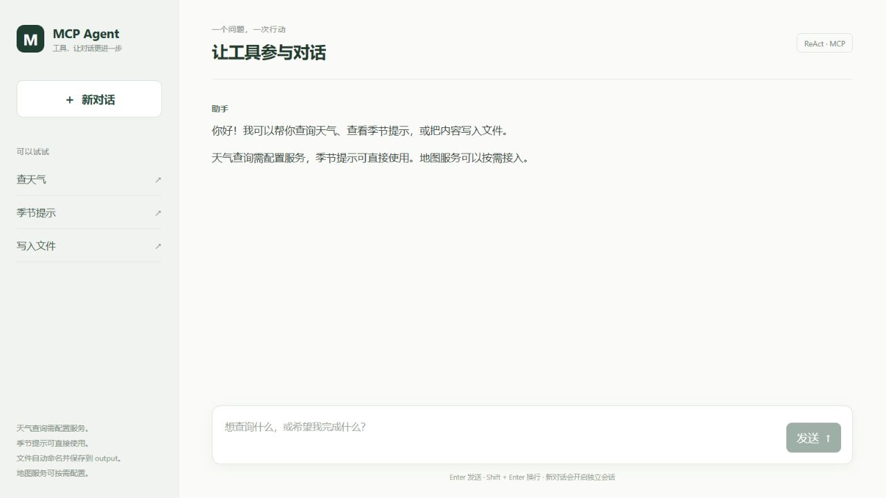
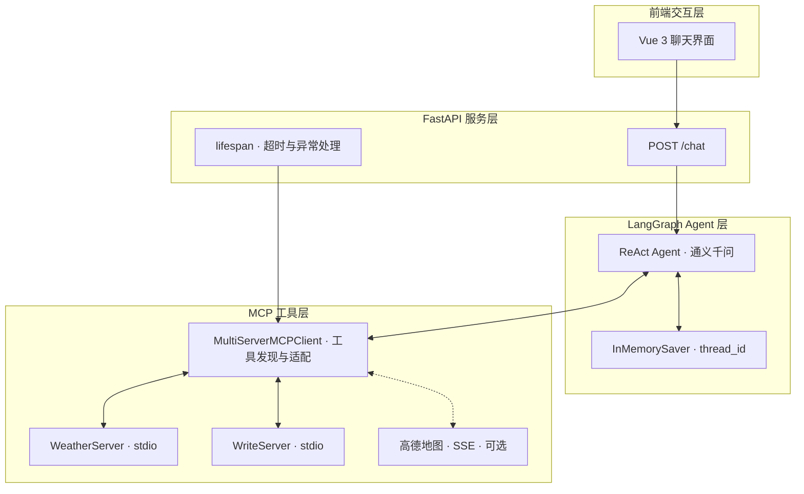
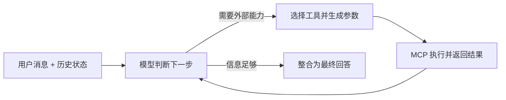

# MCP ReAct Agent

**基于 MCP 协议的可扩展 ReAct 智能 Agent 系统**

[](https://www.python.org/)
[](https://vuejs.org/)
[](https://fastapi.tiangolo.com/)
[](https://modelcontextprotocol.io/)
[](LICENSE)

简体中文 · [English](README.en.md)

一个可以本地运行的完整 Agent Web 应用：用户通过 Vue 聊天界面提出需求，FastAPI 将请求交给 LangGraph ReAct Agent，通义千问根据工具描述和参数 Schema 选择 MCP 工具，再根据工具结果继续判断或生成回答。

本项目根据用户提供的功能需求与学习原型进行独立实现，围绕四层架构构建配置加载、会话隔离、资源生命周期和 Web 交互。适合学习 MCP 工具接入、理解 Agent 调用循环，以及展示从命令行入口到 Web 应用的完整工程实现。



欢迎页面截图；模型与外部服务需按下文配置。

<!-- TOC -->
- [核心能力](#核心能力)
- [架构与执行流程](#架构与执行流程)
- [快速开始](#快速开始)
- [示例对话](#示例对话)
- [配置与工具](#配置与工具)
- [API](#api)
- [新增 MCP 服务](#新增-mcp-服务)
- [源码导航](#源码导航)
- [会话与使用边界](#会话与使用边界)
- [开发验证](#开发验证)
- [常见问题](#常见问题)
- [参考与致谢](#参考与致谢)
<!-- /TOC -->

## 核心能力

| 能力 | 实现 |
| --- | --- |
| 自主选择与串联工具 | LangGraph ReAct 循环，结合通义千问生成工具调用与参数 |
| MCP 工具接入 | 两个本地 FastMCP Server，包含天气查询、季节提示、文件写入三个工具 |
| 异构服务配置 | `servers_config.json` 统一声明 stdio 与 SSE 服务，启动时发现并加载工具 |
| 可选地图扩展 | 高德地图 SSE 接入配置，默认关闭；开启后从远程服务发现工具 |
| 多轮对话 | `InMemorySaver` 按 `thread_id` 保存进程内检查点，前端生成独立会话 ID |
| Web 交互 | Vue 聊天界面、Markdown 渲染、加载反馈、异常提示、HTML 禁用与链接协议过滤 |
| 生命周期管理 | FastAPI `lifespan` 持有 MCP 会话，在服务退出时释放连接与子进程 |
| 故障可见性 | 必需服务连接失败时停止启动；可选服务失败时降级，并通过健康接口显示 |

## 架构与执行流程





Agent 使用加载得到的工具集合，不包含按关键词匹配的业务 `if-else` 分支。接入新的兼容 MCP 服务时，通常只需实现服务并添加配置，再重启应用，无需修改 Agent 推理主流程。这里的“动态加载”指**启动时发现工具**，尚未实现运行期间热插拔。

更多细节见 [架构说明](docs/architecture.md)；简历中的五项工作与源码对应关系见 [源码与项目描述映射](docs/source-map.md)。

## 快速开始

### 1. 环境与密钥

- Python **3.11 或以上**，建议使用 Python 3.11 创建虚拟环境。
- Node.js **22.12 或以上**，或 **20.19 或以上的 20.x**，以及 npm。
- 可用的通义千问 / DashScope API Key，用于 Agent 推理。
- 天气查询需要 OpenWeather API Key；季节提示与文件写入工具本身不需要天气 Key。

```bash
git clone https://github.com/Lh0326/mcp-react-agent.git
cd mcp-react-agent
```

Windows PowerShell：

```powershell
py -3.11 -m venv .venv
.\.venv\Scripts\Activate.ps1
python -m pip install -r requirements.txt
Copy-Item .env.example .env
```

macOS / Linux：

```bash
python3.11 -m venv .venv
source .venv/bin/activate
python -m pip install -r requirements.txt
cp .env.example .env
```

编辑项目根目录的 `.env`：

```dotenv
DASHSCOPE_API_KEY=your_dashscope_api_key
MODEL=qwen-plus
OPENWEATHER_API_KEY=your_openweather_api_key

# 默认不启用地图服务；启用方式见下方“配置与工具”。
AMAP_MCP_SSE_URL=
CORS_ORIGINS=http://localhost:5173,http://127.0.0.1:5173
AGENT_TIMEOUT_SECONDS=120
```

不要把真实密钥放入配置文件或提交到 Git。发布目录提供 `.env.example`，实际 `.env` 已被忽略。

### 2. 启动后端

在已激活的虚拟环境中运行：

```bash
python api_server.py
```

默认地址：`http://127.0.0.1:8000`。

- API 文档：<http://127.0.0.1:8000/docs>
- 健康检查：<http://127.0.0.1:8000/health>

本地 MCP 子进程由后端自动启动，无需单独启动 `weather_server.py` 或 `write_server.py`。首次启动会加载已启用服务的工具，然后创建 Agent。

### 3. 启动前端

在另一个终端中运行：

```bash
cd frontend
npm ci
npm run dev
```

打开终端显示的页面地址，通常是 <http://localhost:5173>。开发模式下，Vite 将 `/api` 请求代理到 `http://127.0.0.1:8000`。

如果后端地址不同，在 `frontend/.env.local` 中设置 `VITE_API_BASE_URL`，例如 `VITE_API_BASE_URL=http://127.0.0.1:8000`，然后重启前端。直接跨域访问时，还需在根目录 `.env` 的 `CORS_ORIGINS` 中添加实际前端 Origin。

### 4. 命令行体验

无需启动 Web 后端或前端，也可以直接使用同一套配置和 Agent 运行时：

```bash
python client.py
python client_simple.py "获取夏季天气提示，并把提示写入文件。"
```

每个独立运行的客户端拥有自己的 MCP 会话与进程内对话状态；它们不会共享 Web 后端的历史。

## 示例对话

以下是可以输入的演示请求，实际工具顺序与最终回答由模型决定。

**无需 OpenWeather Key 的双工具演示：**

```text
获取夏季天气提示，并将提示整理后写入本地文件。
```

预期可涉及 `get_weather_tips(season="summer")` 和 `write_file(content=...)`。文件保存在项目根目录的 `output/` 下。

**天气查询与结果落盘：**

```text
查询 Beijing 的当前天气，结合冬季提示给出出门建议，并把摘要写入文件。
```

预期可涉及三个本地工具。需要有效的 OpenWeather Key 与网络连接；天气工具返回当前观测信息，不提供未来天气预报。

**同一会话的上下文：**

```text
我下次出行的城市是 Shanghai，请记住。
那个城市现在天气怎么样？
```

在同一浏览器会话中继续对话，或在 API 中使用同一个 `thread_id`。更换 `thread_id` 后，Agent 使用另一个会话的检查点。

**地图扩展：** 开启并成功连接高德 SSE 服务后，可尝试“查找上海虹桥站附近的咖啡店”。远程工具名称与能力由该服务提供，仓库不内置地图工具实现，也不预设其返回结果。

## 配置与工具

### 环境变量

| 变量 | 用途 | 默认 / 要求 |
| --- | --- | --- |
| `DASHSCOPE_API_KEY` | 通义千问模型鉴权 | Agent 对话必需 |
| `MODEL` | 模型名称 | `qwen-plus`，所选模型需支持工具调用 |
| `OPENWEATHER_API_KEY` | OpenWeather 当前天气接口 | 天气查询时必需 |
| `AMAP_MCP_SSE_URL` | 远程高德 MCP SSE 完整地址 | 地图服务开启时填写 |
| `CORS_ORIGINS` | 允许访问 API 的前端 Origin，逗号分隔 | `http://localhost:5173,http://127.0.0.1:5173` |
| `AGENT_TIMEOUT_SECONDS` | 单次 Agent 调用等待上限 | `120` 秒 |

### MCP 服务配置

`servers_config.json` 声明服务，而 `configuration.py` 负责解析配置。默认包含：

| 服务 | 通信方式 | 默认状态 | 失败策略 |
| --- | --- | --- | --- |
| `weather` | `stdio` | 启用 | 必需；初始化失败时后端启动失败 |
| `write` | `stdio` | 启用 | 必需；初始化失败时后端启动失败 |
| `amap-maps` | `sse` | 关闭 | 可选；开启后连接失败则降级运行 |

本地服务的 `command` 使用 `${PYTHON_EXECUTABLE}`，运行时自动替换为当前 Python 解释器。脚本参数中的相对路径根据项目根目录解析，避免虚拟环境、操作系统与启动目录差异带来的硬编码路径问题。

配置支持 `${VAR}` 必填环境变量和 `${VAR:-default}` 默认值语法。天气服务使用 `${OPENWEATHER_API_KEY:-}`，Key 为空时仍可加载季节提示工具。stdio 子进程显式设置 UTF-8，只继承代理 / 证书配置白名单及服务声明的环境变量；模型 Key 不作为工具子进程的环境参数传递。

开启地图服务时：

1. 向 `.env` 填入服务提供方给出的完整 `AMAP_MCP_SSE_URL`。
2. 将 `servers_config.json` 中 `amap-maps.enabled` 改为 `true`，保留 `optional: true`。
3. 重启后端，通过 `/health` 查看实际工具列表与 `degraded_servers`。

SSE 描述的是 **MCP 客户端与远程工具服务的通信**。当前 `/chat` 返回完整 JSON 回答，并不向浏览器流式输出 token。

### 本地工具

| 工具 | Server | 参数 | 行为 |
| --- | --- | --- | --- |
| `query_weather` | `WeatherServer` | `city: str`，如 `Beijing` | 调用 OpenWeather 当前天气接口，返回气温、湿度、风速等信息 |
| `get_weather_tips` | `WeatherServer` | `season: str`：`spring` / `summer` / `autumn` / `winter` | 返回内置季节提示，无外部 API 依赖 |
| `write_file` | `WriteServer` | `content: str` | 在固定的 `output/` 目录创建文本文件，返回写入结果 |

工具的 Python 类型标注与文档字符串会用于生成工具描述和参数 Schema。新增工具应明确参数含义、返回值与副作用，帮助模型正确选择并调用。

## API

### `GET /health`

返回服务状态、模型名称、已加载工具名称和可选服务降级信息。该接口反映初始化结果；健康检查成功不代表外部模型或天气接口已经完成实时调用。

### `POST /chat`

请求中的 `message` 和 `thread_id` 均为必填项。`message` 需为非空文本，最长 20,000 字符；`thread_id` 最长 128 字符，仅接受字母、数字、下划线和连字符。客户端应为不同会话生成不同的 ID。

```json
{
  "message": "获取夏季天气提示，并把提示写入文件。",
  "thread_id": "demo-session-001"
}
```

macOS / Linux：

```bash
curl -X POST http://127.0.0.1:8000/chat \
  -H "Content-Type: application/json" \
  -d '{"message":"获取夏季天气提示，并把提示写入文件。","thread_id":"demo-session-001"}'
```

Windows PowerShell：

```powershell
$requestBody = @{
  message = '获取夏季天气提示，并把提示写入文件。'
  thread_id = 'demo-session-001'
} | ConvertTo-Json
Invoke-RestMethod -Uri 'http://127.0.0.1:8000/chat' -Method Post `
  -ContentType 'application/json; charset=utf-8' -Body $requestBody
```

返回字段：

| 字段 | 含义 |
| --- | --- |
| `content` | 最终回答文本 |
| `status` | 调用状态 |
| `error` | 错误信息，成功时为空 |
| `thread_id` | 对应请求会话 ID |

再次请求时使用相同 `thread_id` 即可接续对话。接口的实际响应 Schema 和 HTTP 状态码请查看运行中的 `/docs`。

## 新增 MCP 服务

例如创建一个只包含加法工具的 `math_server.py`：

```python
from mcp.server.fastmcp import FastMCP

mcp = FastMCP("MathServer")

@mcp.tool()
def add(a: float, b: float) -> float:
    """将两个数相加，返回结果。"""
    return a + b

if __name__ == "__main__":
    mcp.run(transport="stdio")
```

在 `servers_config.json` 的服务映射中新增一项，与已有本地服务并列：

```json
"math": {
  "transport": "stdio",
  "command": "${PYTHON_EXECUTABLE}",
  "args": ["math_server.py"],
  "enabled": true,
  "optional": false
}
```

保持整个 JSON 文件语法有效，重启应用，然后检查 `/health` 是否出现 `add`。Agent 会拿到新工具的描述与 Schema，主推理循环无需改动。

远程服务按相同方式配置 `transport: "sse"` 和 `url`，可以引用 `${ENV_VAR}` 环境变量。服务接口、通信方式与本仓库锁定的依赖版本必须兼容。接入数据库、BI 等系统前，还需在工具服务中实现业务权限、参数校验与访问范围；这些能力不是添加一条配置后自动获得的。

## 源码导航

```text
mcp-react-agent/
├── api_server.py          # FastAPI /chat、/health 与 lifespan
├── runtime.py             # MCP 会话、工具加载、ReAct Agent 与检查点
├── configuration.py       # 环境变量、服务配置与路径解析
├── client.py              # 交互式命令行入口
├── client_simple.py       # 单次命令行调用入口
├── weather_server.py      # 天气查询与季节提示 MCP Server
├── write_server.py        # 文件写入 MCP Server
├── servers_config.json    # stdio / SSE 服务声明
├── agent_prompts.txt      # Agent 系统提示词
├── .env.example           # 环境变量模板
├── requirements.txt       # Python 依赖版本
├── frontend/              # Vue 3 + Vite 前端
│   └── src/components/ChatBox.vue
├── docs/
│   ├── architecture.md    # 架构、生命周期与边界
│   └── source-map.md      # 简历项目描述对应源码
├── CONTRIBUTING.md
└── LICENSE
```

## 会话与使用边界

- **状态保存在内存中。** `InMemorySaver` 在同一后端进程中支持多轮对话；重启会丢失历史。当前启动方式使用单进程，多 worker 部署不能直接共享这些检查点。
- **会话 ID 用于区分上下文。** `thread_id` 不是身份验证或访问控制。演示 API 未实现登录、限流或按用户授权，默认只监听本机；公开部署需补齐这些能力。
- **工具调用会产生实际副作用。** `write_file` 会写入 `output/`，模型请求会使用模型服务额度；天气与地图依赖外部服务可用性和相关账号权限。
- **响应采用异步非流式调用。** 当前实现通过 `ainvoke` 获取完整结果，以符合本项目的调用方式。这是实现选择，不代表 LangGraph 的新版本无法使用流式调用，也不能据此复现历史流式兼容异常。
- **依赖升级需要单独验证。** 本仓库使用 `langchain-mcp-adapters` 接入路径并锁定依赖。其官方仓库已于 2026-09-17 归档，当前 README 指向 `langchain.mcp`；后续迁移应验证工具适配、会话生命周期和调用链。[官方说明](https://github.com/langchain-ai/langchain-mcp-adapters)

本项目没有提供模型输出准确率、吞吐量或延迟基准，示例请求也不等于实测结果。通义千问、天气和地图的实时能力需要在配置有效密钥后验证。

## 开发验证

后端离线测试与前端检查：

```bash
python -m pytest
```

```bash
cd frontend
npm ci
npm test
npm run build
```

后端测试覆盖配置解析、真实 stdio MCP 工具发现与调用、本地 SSE 服务连接、使用模拟模型的 ReAct 多工具循环与会话隔离，以及 API 校验和工具异常行为。模拟模型测试无需 API Key，本地 SSE 测试也不连接高德线上服务；这些检查不代表通义千问、OpenWeather 或高德远程服务的实时调用已经通过。

本地已在 Windows / Python 3.11 通过 **16 项后端测试**，前端 **5 项测试与构建**通过。通义千问模型对象、Agent 与三个本地工具的初始化通过，该检查没有发送模型请求。CI 配置包含 Ubuntu / Windows 后端检查和 Node.js 22 前端检查；实际 CI 结果请查看仓库 Actions。具体开发要求见 [贡献指南](CONTRIBUTING.md)。

## 常见问题

**后端启动失败，提示缺少模型 Key？**

确认已从 `.env.example` 复制 `.env` 并填写 `DASHSCOPE_API_KEY`。`.env` 应放在项目根目录，修改后重启。

**季节提示可以返回，天气查询失败？**

季节提示是本地工具；天气查询另需有效的 `OPENWEATHER_API_KEY`、外部网络与英文城市名。检查工具返回的错误信息，不要把模型生成的天气文本当作成功查询结果。

**前端报网络错误？**

先确认后端 `/health` 可访问，再检查前端代理目标。使用自定义 `VITE_API_BASE_URL` 时确认 URL、端口与 `CORS_ORIGINS`，并在配置修改后重启相关服务。

**没有看到地图工具？**

默认关闭高德 SSE 服务。启用后查看 `/health`；若 `amap-maps` 位于降级列表，检查服务地址、鉴权信息与服务方支持的通信协议。

**为什么退出服务后，历史消息消失了？**

检查点使用进程内存，前端消息展示也不是数据库历史记录。跨重启恢复需要更换持久化检查点并设计历史管理功能。

**能否使用最新 LangGraph / MCP 依赖？**

先按仓库 `requirements.txt` 安装。依赖的 Agent API、MCP 客户端生命周期与通信方式会变化，升级时应按照 [贡献指南](CONTRIBUTING.md) 验证，而不是直接解除版本限制。

## 参考与致谢

README 的组织方式参考了以下官方项目的功能介绍、快速开始、扩展与贡献说明；本仓库文档按实际源码重新编写，没有复制其项目实现。

- [LangGraph ReAct Agent Template](https://github.com/langchain-ai/react-agent)：ReAct Agent 示例与 README 结构。
- [LangChain MCP Adapters](https://github.com/langchain-ai/langchain-mcp-adapters)：多 MCP 服务工具适配与显式会话用法；本项目使用锁定版本。
- [MCP Python SDK](https://github.com/modelcontextprotocol/python-sdk)：MCP 协议客户端与 FastMCP 服务实现。
- [ReAct: Synergizing Reasoning and Acting in Language Models](https://arxiv.org/abs/2210.03629)：ReAct 方法原始论文。

本仓库包含按功能需求独立实现的源码、配置示例与文档。项目描述与实现的对应关系见 [源码映射](docs/source-map.md)。

## 贡献与许可

欢迎提交能复现的问题、改进建议与 PR。开发与验证要求见 [CONTRIBUTING.md](CONTRIBUTING.md)。

本项目使用 [MIT License](LICENSE)。第三方依赖与外部服务分别适用其自身的许可和使用条款。
