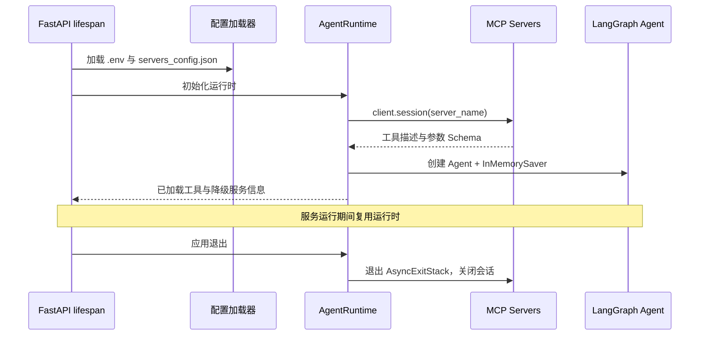
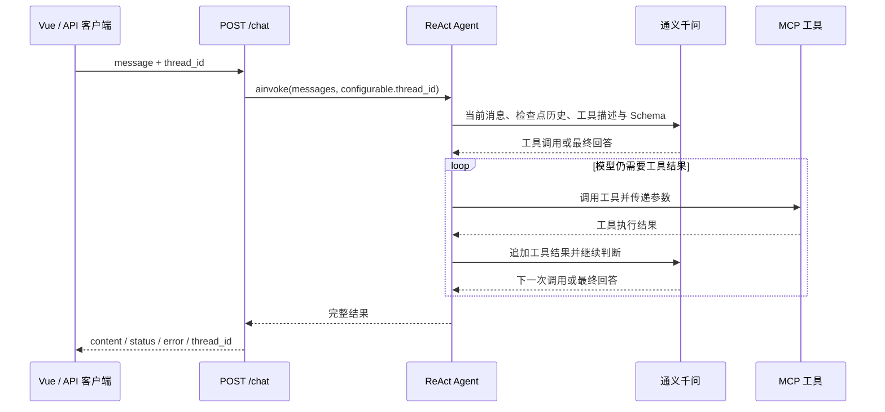

# 架构与运行机制

[返回 README](../README.md)

本项目根据用户提供的功能需求与学习原型进行独立实现，将用户交互、HTTP 接口、Agent 状态与工具实现拆成四层。目标是让 MCP 服务提供工具能力，Agent 根据统一的工具描述和 Schema 选择工具，前端通过稳定的聊天接口展示结果。

## 四层职责

| 层 | 主要文件 | 负责的事情 |
| --- | --- | --- |
| 前端交互层 | [`ChatBox.vue`](../frontend/src/components/ChatBox.vue)、[`vite.config.js`](../frontend/vite.config.js) | 生成会话 ID、发送消息、渲染 Markdown、展示加载与错误状态 |
| FastAPI 服务层 | [`api_server.py`](../api_server.py) | 校验 HTTP 请求、提供 `/chat` 和 `/health`、管理应用生命周期 |
| LangGraph Agent 层 | [`runtime.py`](../runtime.py)、[`agent_prompts.txt`](../agent_prompts.txt) | 创建模型与 ReAct Agent、保存检查点、执行异步非流式调用 |
| MCP 工具层 | [`weather_server.py`](../weather_server.py)、[`write_server.py`](../write_server.py) | 声明工具参数与描述、调用外部天气接口或写入本地文件 |

[`configuration.py`](../configuration.py) 与 [`servers_config.json`](../servers_config.json) 提供跨层配置：环境变量、服务连接参数、Python 解释器与脚本路径。命令行入口和 Web 后端复用 Agent 运行时，避免分别维护工具接入逻辑。

## MCP 服务生命周期

运行时使用 `MultiServerMCPClient` 统一接入不同通信方式，再通过 `load_mcp_tools` 将 MCP 工具转换为 Agent 可用的工具对象。`AsyncExitStack` 持有各个 `client.session()` 上下文，使 MCP 会话的生命周期覆盖 Agent 使用过程；退出时由这些上下文完成清理，而非调用并不存在的通用 `cleanup()` 方法。

本地服务使用 stdio，由当前 Python 环境启动子进程。远程地图配置使用 SSE，与外部 MCP 服务通信。两种方式在工具加载后提供相同的 Agent 工具接口，推理主流程无需判断工具来自哪一种通信协议。

服务配置还包括两个项目级字段：

- `enabled` 决定本次启动是否连接该服务。
- `optional` 决定连接失败是否允许继续启动。必需服务失败会停止初始化；可选服务失败则记录降级状态并保留已可用工具。

这些字段由项目的配置与运行时处理，并不是传给 MCP 协议的工具参数。新增或修改服务后需要重启应用，当前没有工具热更新机制。

## 单次请求与 ReAct 循环

模型可以直接回答，也可以生成一个或多个工具调用；工具结果作为消息返回到 Agent 的状态，再交给模型判断下一步。工具链不是硬编码业务流程，因此“查询天气后写文件”是模型依据用户意图组合出来的行为，具体顺序和输出会受到模型、工具描述及实际返回结果影响。

调用使用 `ainvoke`，API 等待完整结果再发送响应。MCP SSE 与浏览器 token 流式展示是两个独立概念。非流式调用是本项目的实现选择，不能据此断言当前 LangGraph 的流式用法存在兼容缺陷，也不能用新实现证明历史异常的根因。

## 会话状态

`InMemorySaver` 是 Agent 的检查点存储。`thread_id` 相同的调用进入同一会话状态，不同 ID 使用各自的检查点。前端向后端明确发送生成的 ID，不依赖服务端固定默认值。

需要区分三件事：

| 概念 | 本项目行为 |
| --- | --- |
| 跨轮上下文 | 同一后端进程中，相同 `thread_id` 可以延续历史 |
| 跨重启持久化 | 未实现；内存检查点随进程结束丢失 |
| 用户身份与权限 | 未实现；知道会话 ID 不能等同于获得合法访问授权 |

当前启动命令运行单个后端进程。多个 worker 各自拥有内存状态和 MCP 会话，会导致请求落在不同进程时看不到同一历史。计划部署多实例时，应选择共享的持久化检查点后端，并设计认证、会话归属、数据保留与并发控制。

## 工具与副作用

天气查询通过 `httpx` 异步访问 OpenWeather：先将英文城市名作为地理编码接口的 `q` 参数获取经纬度，再查询该位置的当前天气。天气结果依赖 Key、网络和服务响应；内置季节提示不需要这个外部接口。天气服务凭函数签名与文档字符串发布工具参数和说明。

文件写入只接收内容，不接收用户指定的任意文件路径。目标位于项目根目录的固定 `output/` 中。这约束了工具接口的写入范围，但并不构成完整的多用户权限系统。

地图工具由远程服务动态提供。本仓库保留 SSE 配置入口，默认不连接地图服务，因此默认工具集合只有三个本地工具。

## 配置与依赖选择

环境变量用于放置密钥和部署参数；`servers_config.json` 用于描述工具服务。`${PYTHON_EXECUTABLE}` 解析为运行应用的 Python 可执行文件，相对脚本路径按项目根目录解析。这样可以复制仓库到另一台机器后使用虚拟环境，不依赖开发机器的绝对路径。

环境占位符支持 `${VAR}` 与 `${VAR:-default}`。天气 Key 默认可为空，保持季节工具可用；stdio 连接显式设置 UTF-8，并为子进程传递代理 / 证书配置白名单与服务声明的环境变量，避免将模型 Key 作为工具子进程的环境参数传递。

本版本使用 `langgraph.prebuilt.create_react_agent`、`ChatTongyi` 和 `langchain-mcp-adapters`，按照 `requirements.txt` 安装锁定依赖以复现。适配器官方仓库已归档，并将后续开发指向 `langchain.mcp`。[官方说明](https://github.com/langchain-ai/langchain-mcp-adapters) 后续迁移应作为独立改动，重新验证工具发现、显式会话、消息内容与异常传播，避免把新 API 与历史版本说明混用。

## 当前未覆盖的能力

本项目面向本地演示与学习，尚未实现数据库检查点、认证授权、调用审批、生产监控、分布式部署和 token 流式展示。接入业务数据库或 BI 工具时，需在 MCP 服务与应用侧分别补齐业务权限和输入验证。固定工具目录、Markdown HTML 禁用和 Origin 配置是已有约束，不能替代完整的生产部署设计。
